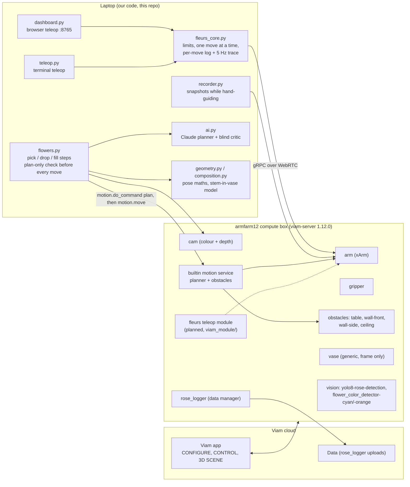
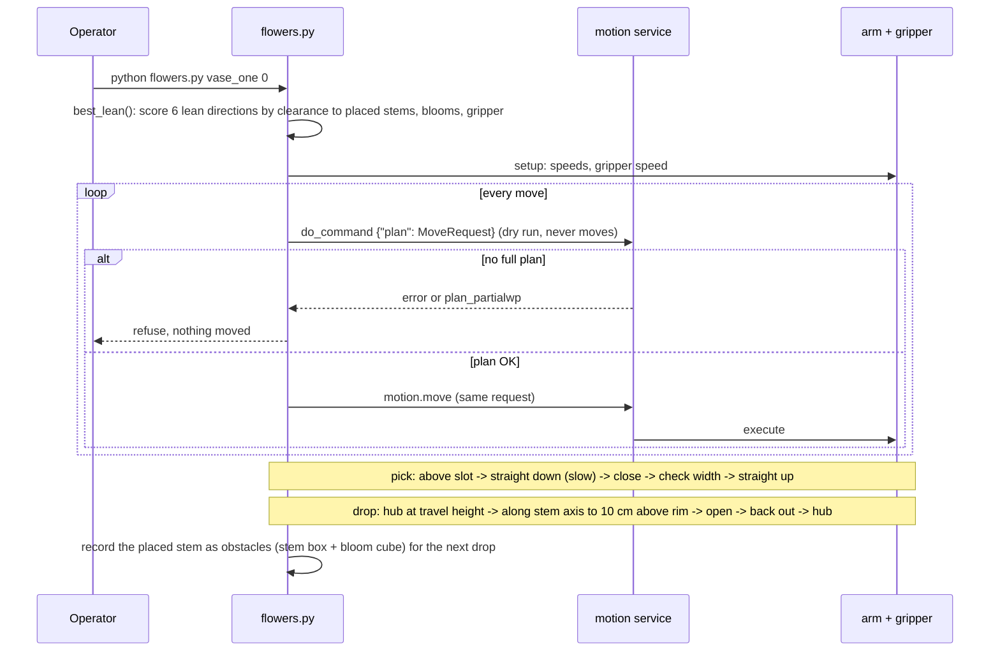
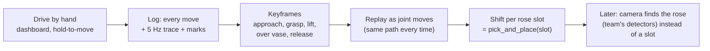

# How Les Fleurs du Viam works

Diagrams render on GitHub. "Live" means read from armfarm12 on 16 Oct afternoon; "planned" means not built or not run yet.

## 1. The pieces and where they run

## 2. What is on the Viam platform right now (live, 16 Oct ~2:45 pm)

| Resource | Type | Who | Notes |
|---|---|---|---|
| `arm` | component, xArm via viam-ufactory-xarm | cell | TCP 105 mm past the flange |
| `gripper` | component | cell | width and speed go through the **arm's** DoCommand |
| `cam` | component, colour + depth | cell | on the wrist, 83 mm behind the flange |
| `table`, `wall-front`, `wall-side`, `ceiling` | obstacles (box geometry) | cell | table top at z -23 per config (not yet touch-checked) |
| `builtin` | motion service | cell | supports the plan-only DoCommand |
| `vase` | generic component | team | **a frame at (360, 234, 118) with no shape**, so the planner doesn't avoid it |
| `yolo8-rose-detection` | vision service | team | rose detector |
| `flower_color_detector-cyan`, `-orange` | vision service | team | colour detectors |
| `rose_logger` | data manager | team | data capture to the cloud |

**Open question:** our arm-measured vase is at (300, -283), rim z 420. The team's `vase` frame is at (360, 234). Either the vase moved to the +y side or one of the two is wrong. `config.VASE` must match where the vase actually is, or the obstacle box protects the wrong spot.

## 3. One pick-and-place, step by step (planned flow for `vase_one`)

## 4. Teleop to automation (the path we're on)

## 5. Measured limits that shape the design

| Fact | Value | How we know |
|---|---|---|
| Teleop accuracy | median 0.13 mm, max 0.2 mm over 103 moves | dashboard logs |
| Highest reachable point over the vase, gripper down | z 600 (680 unreachable) | plan-only checks |
| Wrist angle over the vase | -105° works; -15° makes the wrist hit the camera | plan-only checks |
| Stem allowed below the fingers when crossing the rim | about 140 mm | rim 420 + margin vs z 600 |
| Lean a vase allows | about 18-25° whatever the release angle | our model and a MuJoCo drop test, assumed vase depth |
| Gripper vs placed stems | the gripper, not the flowers, limits the third stem | clearance model |

What this means: top-down grabs can only carry a stem gripped close to its bottom. Roses with the bloom above the grip need the side grasp (gripper horizontal) that people naturally used in manual mode. That path is not plan-checked yet.
