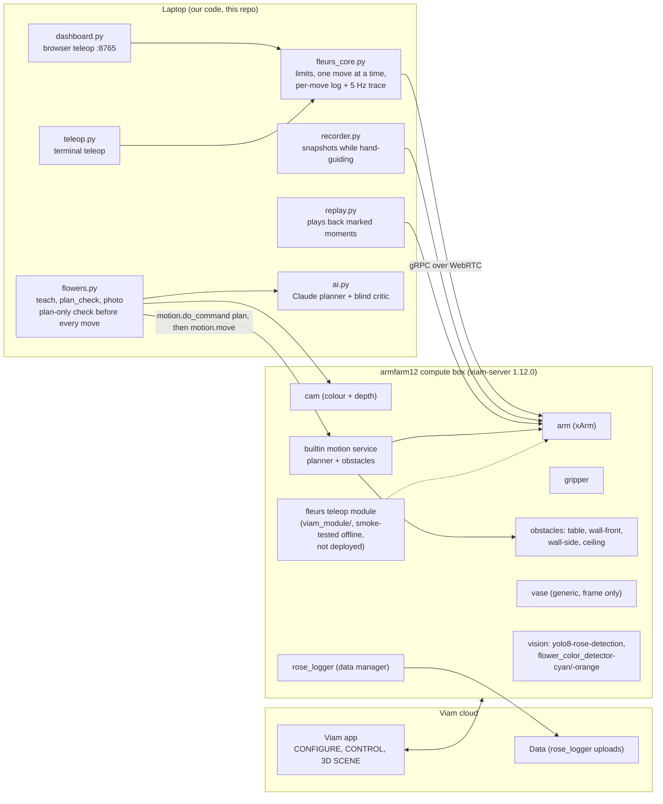
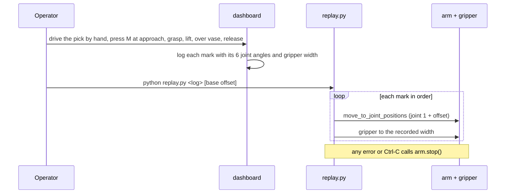
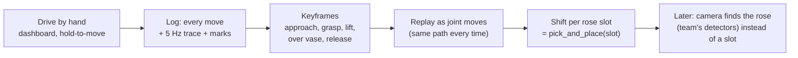
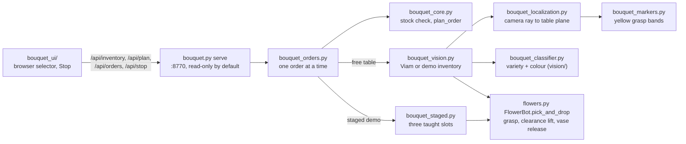

# How Les Fleurs du Viam works

Diagrams render on GitHub. Sections 1 to 5 were written on 16 Oct and describe the machine as read from armfarm12 that afternoon; they are kept as a dated record. Section 6 is the bouquet stack added on 17 Oct. For what ran and what did not, see the README's final state.

## 1. The pieces and where they run

## 2. What is on the Viam platform right now (live, 16 Oct ~2:45 pm)

| Resource | Type | Who | Notes |
|---|---|---|---|
| `arm` | component, xArm via viam-ufactory-xarm | cell | TCP 105 mm past the flange |
| `gripper` | component | cell | width and speed go through the **arm's** DoCommand |
| `cam` | component, colour + depth | cell | on the wrist, 83 mm behind the flange |
| `table`, `wall-front`, `wall-side`, `ceiling` | obstacles (box geometry) | cell | table top at z -23 per config (not yet touch-checked) |
| `builtin` | motion service | cell | supports the plan-only DoCommand |
| `vase` | generic component | team | **a frame at (360, 234, 118) with no shape**, so the planner doesn't avoid it |
| `yolo8-rose-detection` | vision service | team | rose detector |
| `flower_color_detector-cyan`, `-orange` | vision service | team | colour detectors |
| `rose_logger` | data manager | team | data capture to the cloud |

**Open question:** our arm-measured vase is at (300, -283), rim z 420. The team's `vase` frame is at (360, 234). Either the vase moved to the +y side or one of the two is wrong. `config.VASE` must match where the vase actually is, or the obstacle box protects the wrong spot.

## 3. One pick-and-place by replay (16 Oct plan)

This was the plan on 16 Oct. The loop that ran on 17 Oct went a different way: `flowers.py pretend_loop` and `pick_and_drop` move through the five poses saved in `taught_poses.json` (approach, grasp, lift, vase approach, release) with a plan-only check before each move. `replay.py` is still in the repo.

## 4. Teleop to automation (16 Oct plan)

## 5. Measured limits that shape the design

| Fact | Value | How we know |
|---|---|---|
| Teleop accuracy | median 0.13 mm, max 0.2 mm over 103 moves | dashboard logs |
| Highest reachable point over the vase, gripper down | z 600 (680 unreachable) | plan-only checks |
| Wrist angle over the vase | -105° works; -15° makes the wrist hit the camera | plan-only checks |
| Stem allowed below the fingers when crossing the rim | about 140 mm | rim 420 + margin vs z 600 |
| Lean a vase allows | about 18-25° whatever the release angle | our model and a MuJoCo drop test, assumed vase depth |
| Gripper vs placed stems | the gripper, not the flowers, limits the third stem | clearance model |

What this means: top-down grabs can only carry a stem gripped close to its bottom. Roses with the bloom above the grip need the side grasp (gripper horizontal) that people naturally used in manual mode. That path was not plan-checked on 16 Oct.

Other rules we worked by on 16 Oct:
- A pose is the fingertip point: Viam reports the TCP, set 105 mm past the flange. The README's final state confirms commanded arm poses sit 105 mm back from the taught gripper poses.
- Travel height while carrying = rim + stem length below the grip + about 4 cm, so trim stems and grip low.
- The vase sets the lean (about atan(span / depth)); we choose only its direction.
- The planner does not know about the held stem. Cross at travel height and descend along the stem's own line.
- Grip is a set width, not a force. Strip leaves and thorns from the bottom of each stem so they do not snag.

## 6. The bouquet stack (17 Oct)

Physical orders need `--allow-motion` plus a verified calibration (`vision_inventory.json`) or a verified staged profile (`staged_demo.json`), and a verified `transfer_clearance.json`. All three are unverified in the committed files. Details: [vision-bouquet.md](vision-bouquet.md), [staged-demo.md](staged-demo.md).
